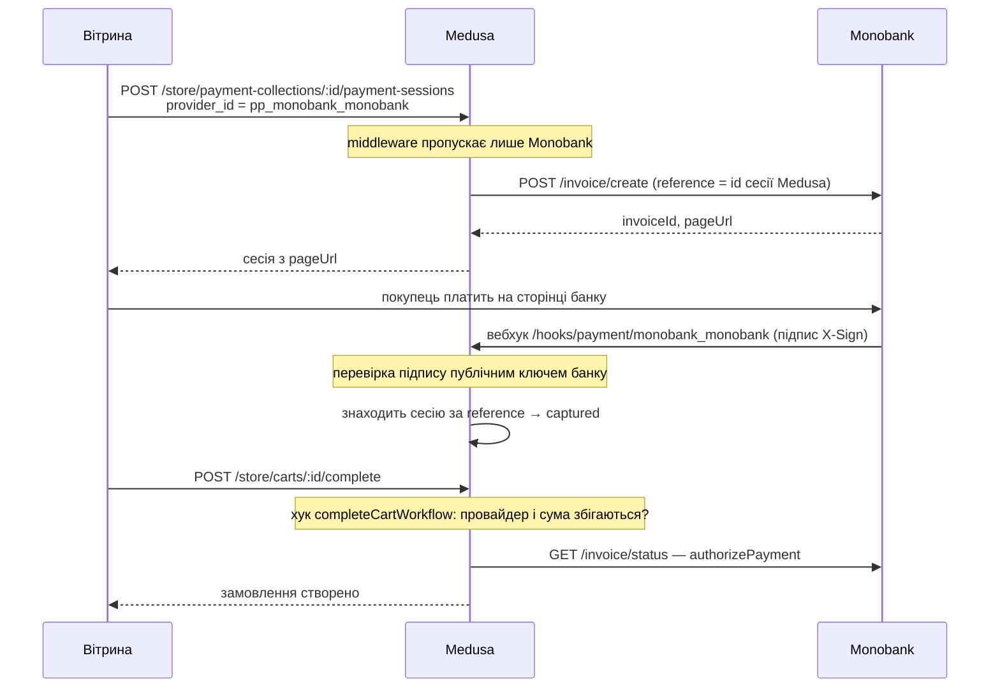

# Medusa v2: оплата Monobank і кастомна адмінка

Робочий приклад бекенду на [Medusa v2](https://docs.medusajs.com), витягнутий із реального інтернет-магазину. Тут два готові шматки, які можна перенести у свій проєкт:

1. **Оплата через Monobank** (інтернет-еквайринг): платіжний провайдер, перевірка підпису вебхука, захист від «безкоштовних» замовлень.
2. **Розширення адмінки**: віджети на сторінці товару, окрема сторінка «Новий товар» на одному екрані, автоматична обробка фото, відгуки, платні опції до товару.

> English: a Medusa v2 backend example with a Monobank (Ukraine) payment provider with signed webhooks and checkout guards, plus admin widgets, a one-screen product form, 1000×1000 WebP image processing, product reviews and paid add-ons. Code comments are partly in Russian/Ukrainian.

---

## Зміст

- [Що всередині](#що-всередині)
- [Швидкий старт](#швидкий-старт)
- [Оплата Monobank](#оплата-monobank)
- [Адмінка](#адмінка)
- [API-маршрути](#api-маршрути)
- [Як перенести у свій проєкт](#як-перенести-у-свій-проєкт)
- [Тести](#тести)
- [Типові проблеми](#типові-проблеми)

---

## Що всередині

```
src/
├── modules/
│   ├── monobank/                 # платіжний провайдер
│   │   ├── client.ts             #   HTTP-клієнт API банку + перевірка підпису
│   │   ├── service.ts            #   AbstractPaymentProvider: створення рахунку, статуси, повернення
│   │   ├── webhook.ts            #   подія банку → дія Medusa (чиста функція, покрита тестом)
│   │   └── index.ts
│   └── reviews/                  # власний модуль: таблиця відгуків
├── workflows/
│   ├── reviews.ts                # створення / видалення відгуку з відкатом
│   └── hooks/validate-cart-completion.ts   # остання перевірка перед створенням замовлення
├── api/
│   ├── middlewares.ts            # дозволений провайдер оплати, rate limit, ліміт завантажень, security headers
│   ├── admin/
│   │   ├── simple-products/      # POST: товар з однієї форми
│   │   ├── uploads/              # заміна стандартного завантаження: фото → 1000×1000 WebP
│   │   ├── products/[id]/reviews # GET/POST відгуки товару
│   │   └── reviews/[id]          # DELETE відгук
│   └── store/
│       ├── carts/[id]/addon-items  # додати в кошик товар із платними опціями
│       └── reviews/              # GET відгуки для вітрини
├── admin/
│   ├── routes/new-product/       # сторінка «Новий товар» (/app/new-product)
│   ├── widgets/                  # віджети: опції, відгуки, кнопка створення, мова адмінки
│   └── lib/api.ts                # fetch до admin API з сесією адмінки
└── lib/                          # чиста логіка без Medusa-контейнера, покрита unit-тестами
```

Уся бізнес-логіка, яку можна перевірити без бази даних, лежить у `src/lib` і має тести в `src/lib/__tests__`.

---

## Швидкий старт

Потрібно: **Node.js 20.19+ або 22.12+** і **PostgreSQL**.

```bash
git clone https://github.com/Kinstering/medusa-monobank-admin-example.git
cd medusa-monobank-admin-example
npm install
cp .env.template .env        # заповніть DATABASE_URL, JWT_SECRET, COOKIE_SECRET
npx medusa db:migrate        # створить таблиці, зокрема review
npx medusa user -e admin@example.com -p supersecret   # перший адміністратор
npm run dev
```

Адмінка відкриється на http://localhost:9000/app.

Перед тим як створювати товари, налаштуйте в адмінці (Settings):

1. **Store → Currencies**: додайте `UAH`.
2. **Regions**: регіон з валютою UAH. Після запуску з `MONOBANK_TOKEN` у ньому з'явиться провайдер `pp_monobank_monobank`, увімкніть його.
3. **Locations & Shipping**: хоча б один склад (потрібен формі «Новий товар» для залишків).

---

## Оплата Monobank

### Як проходить платіж



### Що тут захищено і чому

| Ризик | Де закрито |
|---|---|
| Medusa завжди реєструє `pp_system_default`, який «авторизує» платіж без банку. Сесія на ньому дає безкоштовне замовлення. | `src/api/middlewares.ts` (на маршруті створення сесії) **і** `src/workflows/hooks/validate-cart-completion.ts` (на будь-якому шляху до замовлення). Дві перевірки, бо перша прив'язана до форми маршруту. |
| Підроблений вебхук «оплачено». Адреса вебхука публічна. | `client.ts → verifySignature`: підпис ECDSA перевіряється по **сирих** байтах тіла. Ключ банку кешується; якщо підпис не зійшовся, ключ перечитується один раз (ротація ключа). |
| Вебхук повертає `invoiceId` банку замість id сесії Medusa: гроші списано, замовлення немає. | `webhook.ts` повертає `session_id` з `reference` рахунку; `webhook.unit.spec.ts` це перевіряє. |
| Кошик змінили після створення рахунку. | `authorizePayment` звіряє суму рахунку з сесією; `assertPayableCart` звіряє суму сесії з кошиком **у копійках**, не як дробові числа. |
| Замовлення створюється «в очікуванні оплати». | `authorizePayment` ніколи не повертає `pending_authorization`: або банк підтвердив (`success` / `hold`), або помилка, і кошик не завершується. |
| Часткове повернення тихо стає повним. | `refundPayment` відкидає суму, що не є додатним числом. |

### Налаштування

У `.env`:

```env
MONOBANK_TOKEN=...                 # токен еквайрингу; тестовий токен працює з тестовими картками
MEDUSA_BACKEND_URL=https://...     # публічна адреса бекенду, на неї банк шле вебхуки
MONOBANK_REDIRECT_URL=https://.../checkout/result
```

Локально вебхук не дійде на `localhost`, тому для тесту оплати потрібен тунель (`ngrok http 9000` або `cloudflared`), а його адресу треба вказати в `MEDUSA_BACKEND_URL`.

---

## Адмінка

Розширення зроблені штатними засобами Medusa Admin SDK: `defineWidgetConfig` (віджети) і `defineRouteConfig` (нові сторінки).

| Файл | Де видно | Що робить |
|---|---|---|
| `routes/new-product/page.tsx` | меню → «Новий товар» | Товар без варіантів на одному екрані: назва, ціна, кількість, категорія, фото, платні опції. Зберігає через `POST /admin/simple-products`. |
| `widgets/product-list-create.tsx` | над списком товарів | Кнопка, що веде на форму вище замість стандартного майстра. |
| `widgets/product-addons.tsx` | сторінка товару | Редактор платних опцій (`«Фарбування» +150 грн`), зберігається в `metadata.addons`. |
| `widgets/product-reviews.tsx` | сторінка товару | Додати / видалити відгук (ім'я, оцінка, дата, текст). |
| `widgets/default-language.tsx` | сторінка входу | Під час першого входу вмикає українську мову адмінки, далі не заважає вибору користувача. |

**Фото товарів.** `src/api/admin/uploads/route.ts` перекриває стандартний обробник завантаження (той самий шлях, тому multer Medusa все ще розбирає файл). Кожне растрове фото приводиться до **1000×1000 WebP** (`sharp`): поворот за EXIF, без обрізання (`fit: contain`), прозоре поле для PNG, біле для фото. SVG і CSV проходять без змін.

**Платні опції.** Вітрина надсилає лише id опцій, а ціну рядка рахує сервер (`src/lib/addons.ts`): ціна варіанта в регіоні кошика плюс опції, у копійках. Тому підробити ціну в запиті не вийде. Невідомий id опції повертає помилку, а не мовчки ігнорується.

---

## API-маршрути

| Метод | Шлях | Доступ | Опис |
|---|---|---|---|
| POST | `/admin/simple-products` | адмін | Створити товар з однієї форми |
| POST | `/admin/uploads` | адмін | Завантажити фото (→ 1000×1000 WebP) |
| GET / POST | `/admin/products/:id/reviews` | адмін | Відгуки товару |
| DELETE | `/admin/reviews/:id` | адмін | Видалити відгук |
| POST | `/store/carts/:id/addon-items` | publishable key | `{ variant_id, quantity, addon_ids? }` |
| GET | `/store/reviews?handle=` | publishable key | Відгуки опублікованого товару + середня оцінка |
| POST | `/hooks/payment/monobank_monobank` | банк (підпис) | Вебхук Monobank (маршрут Medusa) |

---

## Як перенести у свій проєкт

**Тільки оплата Monobank:**

1. Скопіюйте `src/modules/monobank/`, `src/lib/payment-guard.ts`, `src/workflows/hooks/validate-cart-completion.ts`.
2. Додайте `restrictPaymentProvider` з `src/api/middlewares.ts` у свої middlewares.
3. Зареєструйте провайдера в `medusa-config.ts` (блок `if (process.env.MONOBANK_TOKEN)`).
4. Увімкніть `pp_monobank_monobank` у регіоні.

На вітрині після створення сесії перенаправте покупця на `payment_session.data.pageUrl`, а коли він повернеться, викличте `POST /store/carts/:id/complete`.

**Тільки відгуки:** `src/modules/reviews/`, `src/workflows/reviews.ts`, `src/lib/reviews.ts`, маршрути `api/admin/products/[id]/reviews`, `api/admin/reviews`, `api/store/reviews`, віджет `product-reviews.tsx` і `src/admin/lib/api.ts`. Потім зареєструйте модуль у `medusa-config.ts` і виконайте `npx medusa db:migrate`.

**Тільки обробка фото:** `src/api/admin/uploads/route.ts` + `src/lib/product-image.ts` + залежність `sharp`.

---

## Тести

```bash
npm run test:unit
```

Unit-тести покривають чисту логіку: захист оплати, вебхук Monobank, ціну з опціями, розбір форм, транслітерацію назв у URL, обробку фото та rate limit.

---

## Типові проблеми

| Симптом | Причина |
|---|---|
| `Timeout acquiring a connection` під час міграцій | Малий пул knex. У `medusa-config.ts` `pool` лежить у **корені** `databaseDriverOptions` (не в `connection`, як у документації). |
| Віджет падає з `$RefreshReg$ has already been declared` | `admin.vite` повертає `...config`. Треба повертати лише свої зміни. |
| Провайдер Monobank не видно в регіоні | Не задано `MONOBANK_TOKEN`, тоді провайдер навмисно не реєструється. |
| Оплата пройшла, замовлення немає | Вебхук не дійшов (локальний `MEDUSA_BACKEND_URL`) або змінився кошик. Шукайте в логах `ОПЛАЧЕН ... сессия удалена`. |
| Ціни товарів 0 на вітрині | Немає регіону у валюті магазину або в запиті не вказано `*variants.calculated_price`. |

---

Ліцензія: MIT.
